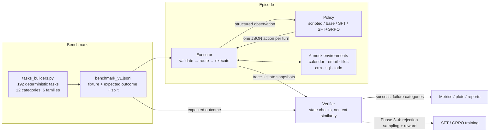

# ToolForge

**Execution-verified tool-use training and evaluation for small language models.**

ToolForge trains and evaluates a small open model (target: Qwen3-0.6B → 1.7B-class, QLoRA)
on tool-use tasks inside six deterministic, sandboxed mock environments. Task success is
computed from the **actual resulting environment state** — not from text similarity with a
reference answer — which makes the same verifier usable for benchmarking, rejection-sampled
SFT data, and GRPO rewards.

**Central research question:** *Can execution-verified SFT followed by GRPO improve the
task-completion accuracy of a small open model on tool-use tasks, including unseen tool
families, without an unacceptable increase in latency or inference cost?* The experiments
will determine the answer; nothing is assumed.

> **Status: Phases 1–2 complete** (foundation: environments, executor, verifier,
> benchmark; evaluation: inference policies, metrics with CIs, resumable runner,
> latency/cost benchmarking, MCP adapter). Phases 3–6 (SFT, GRPO, ablations,
> Colab/demo) follow. **No results are reported anywhere in this repository
> until real runs exist.**

---

## Architecture



## Repository layout (Phase 1)

```text
ToolForge/
├── configs/base.yaml            # env/benchmark/paths settings (strict key validation)
├── configs/evaluation.yaml      # evaluation defaults: split, repeat, generation, model
├── src/toolforge/
│   ├── config.py                # dataclass configs, YAML loading, ConfigError on typos
│   ├── schemas.py               # action grammar (+ GRAMMAR_VERSION), ToolSpec, schema validator
│   ├── timeutils.py             # date/time helpers, free-range computation (fixed simulated clock)
│   ├── registry.py              # EnvironmentRegistry + ToolRouter (multi-family episodes)
│   ├── executor.py              # episode loop: parse → validate → execute → trace, loop guard
│   ├── verifier.py              # declarative state checks, side-effect diffing, verdicts
│   ├── tasks.py                 # Task/ExpectedOutcome model, splits, leakage checks, JSONL I/O
│   ├── tasks_builders.py        # deterministic benchmark construction (templates + handwritten)
│   ├── inference.py             # policies: HuggingFace (+adapter), Random baseline, OpenAI-compatible
│   ├── metrics.py               # aggregation, Wilson + bootstrap CIs, clarification P/R/F1
│   ├── evaluation.py            # preflight, resumable runner, per-task prediction records
│   ├── benchmarking.py          # latency/throughput/token/cost measurement (labeled estimates)
│   ├── mcp_adapter.py           # OPTIONAL MCP server over the same envs (core never imports it)
│   └── environments/            # base.py, calendar.py, email.py, files.py, crm.py, sql.py,
│                                # todo.py, pools.py, registry.py
├── scripts/generate_tasks.py    # regenerate data/tasks/benchmark_v1.jsonl
├── scripts/evaluate.py          # evaluate any policy on any split (resumable)
├── scripts/benchmark_inference.py  # latency / throughput / token / cost measurement
├── tests/                       # 316 CPU-only tests (no model downloads)
├── data/tasks/                  # generated benchmark (JSONL + summary)
└── configs, LICENSE (.env.example, requirements*.txt, pyproject.toml)
```

Deliberate deviations from the original tree: `tasks.py` + `tasks_builders.py` +
`verifier.py` + `timeutils.py` were added (benchmark content vs. plumbing separation),
task management lives in `environments/todo.py` (name collision with benchmark tasks),
and there is a single registry (`registry.py`) plus default-registration
(`environments/registry.py`). `rewards.py`, `data_generation.py`,
`checkpointing.py` and training scripts arrive in Phases 3–4.

## Installation (CPU-only core)

```bash
git clone <this repo> && cd ToolForge
python -m pip install -r requirements-dev.txt   # PyYAML + pytest
# or: python -m pip install -e ".[dev]"
```

Python ≥ 3.10. The core has **no torch/transformers dependency** — environments,
executor, verifier, and benchmark generation run on any CPU (verified on 3.11).

## Tests

```bash
python -m pytest tests/ -q          # 316 tests, ~2 s, CPU-only, no downloads
```

Covered: schema validation and action parsing (incl. malformed-output categories),
environment determinism/isolation/reset, per-family state transitions, SQL safety
(authorizer denials, multi-statement rejection, runaway-CTE abort), executor loop
(step limit, loop guard, error feedback, context hygiene), verifier checks and
failure categories, benchmark determinism, split integrity, and leakage prevention.

## Benchmark

```bash
python scripts/generate_tasks.py --config configs/base.yaml
# -> data/tasks/benchmark_v1.jsonl (192 tasks) + benchmark_v1_summary.json
```

| Split | Tasks | Notes |
|---|---|---|
| train | 116 | excludes the held-out family entirely |
| val | 17 | hyperparameter selection only |
| test | 59 | includes all 31 `crm` (held-out family) tasks |

- **12 categories**: single-step selection (31), argument construction (25), multi-step
  workflows (28), retrieve-then-act (28), dependent actions (15), ambiguous→clarify (13),
  missing-info→no-action (9), invalid-tool bait (12), indirect reference (10), error
  recovery (11), conflicting constraints (4), impossible tasks (6).
- **6 families**: calendar (38), email (33), files (30), crm (31 — *held out from
  training*), sql (27), todo (33).
- Splits are assigned by a stable hash of `(salt, task_id)`; held-out families go
  entirely to test; every category is guaranteed ≥1 test task; `check_no_leakage` fails
  loudly on any violation. Building twice is byte-identical (tested).
- Every task embeds its **full explicit fixture**, so expected outcomes can never drift
  when generators change.

### Task record (JSONL, abbreviated)

```json
{"task_id": "tf-cal-ss-001", "family": "calendar", "category": "single_step_selection",
 "request": "Create a calendar event titled 'Project review' on 2026-03-04 from 13:00 to 14:00.",
 "fixture": {"current_date": "2026-03-02", "events": [...], ...},
 "tool_families": ["calendar"], "max_steps": 3, "split": "train",
 "expected": {"terminal_action": "final_answer", "forbid_state_changes": false,
   "checks": [{"check": "record_exists", "collection": "events",
               "where": {"title": "Project review", "date": "2026-03-04",
                          "start": "13:00", "end": "14:00", "status": "scheduled"}}]}}
```

## Action grammar (frozen — used identically in training, inference, and evaluation)

The model emits exactly one JSON object per turn:

```json
{"action": "tool_call", "tool": "calendar.create_event", "arguments": {"title": "...", "date": "2026-03-04", "start": "13:00", "end": "14:00"}}
{"action": "clarify", "question": "Which day works for you?"}
{"action": "final_answer", "content": "Done — created the event."}
```

Parsing tolerates prose around the JSON and ```` ```json ```` fences, but is strict about
structure. Failures are categorized (`invalid_json`, `unknown_action`, `missing_field`,
`field_type_error`, `unexpected_field`, `tool_name_format`) and fed back to the model as
structured error observations; they count toward the step budget and the invalid-call
metrics.

## Environments and verifier

Six deterministic mock environments with in-memory state, a fixed simulated clock
(`current_date = 2026-03-02`, never the system time), isolated per-episode instances,
JSON-serializable snapshots, and structured tool errors (`not_found`,
`invalid_argument`, `already_exists`, `ambiguous`, `unsafe_operation`, `unsupported`,
`limit_exceeded`, `unknown_tool`, `internal_error`). The SQL family enforces read-only
execution with a SQLite authorizer (writes/DDL/ATTACH/PRAGMA denied), single-statement
queries, a VM-step cap against runaway recursion, and row truncation.

The **verifier** decides success from:
1. terminal action (final_answer vs clarify vs none) against the expected behavior,
2. a forbidden-side-effect diff between initial and final state snapshots (ignoring each
   family's declared volatile keys, e.g. email `read` flags),
3. declarative checks — `record_exists/absent`, `record_count`, `field_equals`,
   `no_overlaps`, `tool_called(+arguments_match)`, `tool_not_called`,
   `answer_contains_all/any`, `invalid_calls_at_most` — where ground truth was **computed
   from the fixture at build time**,
4. step-limit / loop-guard termination.

Anti-reward-hacking properties (all tested): claiming success without acting fails;
acting when forbidden fails even with a correct answer; a no-op episode passes **zero**
of the 192 tasks; no-action tasks must also surface the missing information; the
model-visible context provably never contains expected outcomes; repeated identical
calls trigger the loop guard instead of accumulating reward. Lexical answer checks are
used only where state cannot express correctness (information retrieval, refusals) and
are documented as such.

## Evaluation (Phase 2)

One interface for every model — base, SFT adapter, SFT+GRPO adapter, or an
optional external teacher API. All policies face identical tasks, tool
definitions, step limits, initial states, and verifier rules.

```bash
# CPU smoke test, no model download (random baseline policy):
python scripts/evaluate.py --policy random --split test --limit 12 --run-name random-smoke

# Base model on the test split (needs pip install -e ".[hf]"; GPU recommended):
python scripts/evaluate.py --policy hf --model-id Qwen/Qwen3-0.6B --split test \
    --run-name base-0.6b

# Adapter checkpoint (SFT or GRPO), main-experiment model:
python scripts/evaluate.py --policy hf --model-id Qwen/Qwen3-1.7B \
    --adapter-id outputs/checkpoints/sft-final --split test

# Repeat-run variability with sampling (3 passes, per-run seeds recorded):
python scripts/evaluate.py --policy hf --do-sample --repeat 3 --split val

# Optional teacher API (only with an explicitly configured key env var):
export OPENAI_API_KEY=...   # never hardcoded, never required by the core
python scripts/evaluate.py --policy api --api-model gpt-4o-mini --split test
```

Each run writes to `outputs/eval/<run-name>/`:

- `predictions.jsonl` — per-task records: verdict, failure categories, full
  tool-call trace, initial+final environment states, token counts, timings,
  sampling seed, policy id. **Metrics recompute from this file alone**
  (`toolforge.evaluation.reaggregate`) — verified by tests.
- `metrics.json` / `metrics.csv` — aggregates (below).
- `run_config.json` — grammar version, tool-catalog fingerprints, generation
  and model settings, full config snapshot, argv.

Guarantees (all tested):

- **Preflight before compute**: every fixture loads and every check spec
  resolves before the first generation; broken tasks abort the run.
- **Schema-compatibility fingerprints**: the tool catalog + grammar version are
  hashed per run; Phase 5 comparisons refuse to diff runs with mismatched
  fingerprints.
- **Resumable**: predictions flush per task; interrupted Colab sessions resume
  by skipping completed `(task_id, run_index)` pairs. `--no-resume` refuses to
  touch an existing predictions file.
- **Policy failures are data, not silence**: exceptions become recorded
  `policy_error` episodes; error storms (>50% of tasks) abort the run instead
  of reporting infrastructure failure as model quality.

### Metrics

Reported per run (exact formulas in `src/toolforge/metrics.py`): success rate
overall / by category / by family / by difficulty / by split; **held-out family
success**; multi-step and workflow-like success; **clarification precision /
recall / F1** (tasks accepting either terminal action are excluded from the
label set); invalid-JSON rate; invalid-tool-call rate; argument-validation
failure rate; step-limit and loop-guard rates; unwanted-side-effect rate;
failure-category counts; tool calls and turns per task; completion sizes;
latency (mean/median/p95) split into policy vs. environment time;
time-to-successful-completion; token totals when the policy tracks them.

Success-rate intervals: Wilson 95% and a seeded percentile bootstrap over
tasks (`ci_type: "bootstrap_over_tasks"`). Run-to-run *training* variability is
a different quantity and will be labeled as such in Phase 5.

### Inference benchmarking

```bash
python scripts/benchmark_inference.py --policy random --n-tasks 6          # CPU smoke
python scripts/benchmark_inference.py --policy hf --model-id Qwen/Qwen3-0.6B \
    --n-tasks 12 --ttft --gpu-cost-per-hour 0.35 --hardware-label "rented T4"
```

Reports model-load time, warm-up, time-to-first-token (streaming; `null` when
the policy cannot measure it — never substituted), per-turn and per-episode
latency (median/p95 with n), throughput, peak GPU memory (only when CUDA is
actually in use), token totals, and cost per 1,000 tasks **only** when you
supply an hourly rate — then labeled as an estimate with its basis and
hardware string. Policy time and CPU environment time are reported separately.

### MCP adapter (optional)

`src/toolforge/mcp_adapter.py` exposes any environment family as an MCP server
over stdio, using the identical `ToolSpec` schemas and validation:

```bash
pip install "mcp>=2.0"
python -m toolforge.mcp_adapter calendar --seed 0
```

Distinction: the **internal executor** routes tool calls in-process and is the
only path used by benchmarking/training/evaluation; the **adapter** is a
compatibility surface for external MCP clients. The core package never imports
`mcp` (enforced by a subprocess test); adapter calls return the same
structured `{"ok": ..., "error": {...}}` payloads as the executor.
Developed against mcp 2.3.0 (v2 low-level API, with a v1 fallback path).

## Results

| Model | Overall success | Seen families | Held-out (crm) | Invalid-call rate | Latency/task |
|---|---|---|---|---|---|
| Qwen3-0.6B base | *pending Phase 2* | *pending* | *pending* | *pending* | *pending* |
| + SFT (QLoRA) | *pending Phase 3* | *pending* | *pending* | *pending* | *pending* |
| + SFT + GRPO | *pending Phase 4* | *pending* | *pending* | *pending* | *pending* |

No cell in this table will be filled from anything other than saved evaluation runs.

## Roadmap

- **Phase 2 — done** (evaluation harness: policies, metrics + CIs, resumable
  runner, preflight/fingerprints, benchmarking, MCP adapter).
- **Phase 3** — trajectories + SFT: reference/self-generated trajectories with rejection
  sampling, chat-template serialization (loss masked on tool observations), QLoRA training,
  pinned torch/transformers/peft/trl versions (`requirements-train.txt`).
- **Phase 4** — GRPO on top of the SFT policy using the verifier-backed reward.
- **Phase 5** — ablations, plots from real evaluation files only, `compare_models.py`.
- **Phase 6** — Colab notebook, Streamlit demo, full report.

## Installation extras

```bash
python -m pip install -e ".[dev]"   # tests (CPU-only)
python -m pip install -e ".[hf]"    # model-backed evaluation/inference
python -m pip install -e ".[mcp]"   # optional MCP adapter
```

`[hf]` carries lower bounds only (Qwen3 needs transformers>=4.51.0); exact
mutually-compatible pins are finalized in Phase 3 against the real Colab T4
stack rather than guessed here.

## Known limitations

### Phase 1 (foundation)

- **Lexical answer checks**: retrieval/refusal tasks verify computed ground-truth values
  by case-insensitive substring containment; a model can theoretically pass by mentioning
  a value without a correct sentence (mitigated by requesting exact values; state checks
  dominate elsewhere). Count answers can substring-collide with dates/ids (e.g. `3` in
  `2026-03-03`) — requests instruct "answer with the exact number", and Phase 2 metrics
  will report per-category results so any distortion is visible.
- **Single-turn JSON grammar**: no streaming/partial JSON; a turn that emits two JSON
  objects uses the first one.
- **Held-out family = crm only** (configurable): "unseen combinations of known tools"
  (multi-family tasks) are supported by the executor/router but not yet populated in v1
  of the benchmark; they arrive with Phase 2 evaluation slices.
- **Simulated clock**: all fixtures use a fixed `current_date`; relative-time reasoning
  ("tomorrow") is resolved at build time in requests/expectations.
- **SQL dialect**: SQLite; recursive CTEs are allowed but step-capped. The authorizer
  denies `PRAGMA`, so schema discovery goes through `list_tables`/`describe_table`.

### Phase 2 (evaluation)

- **HF policy GPU path not yet exercised on real hardware in this workspace**: the
  transformers code path is unit-tested with injected tokenizer/generate fakes (no
  downloads here); the first real `--policy hf` run happens on your Colab GPU. The
  chat-template call, sampling-seed handling, and streaming TTFT use standard,
  version-stable transformers APIs, but treat the first Colab smoke run as the
  acceptance test and report back any mismatch.
- **No batched generation**: episodes generate one turn at a time (simplest correct
  path for 0.6B on a T4; vLLM/batching is an optional later optimization and would be
  reported as a separate configuration).
- **Clarification P/R** excludes tasks whose expected terminal action is `any`
  (clarify is acceptable there), so it is computed on the labeled subset only.
- **Cost numbers** are estimates derived from measured wall time and a user-supplied
  hourly rate; the sandbox has no GPU, so no GPU cost measurement exists yet.
- **MCP adapter** is verified against mcp 2.3.0 in-process; the v1 fallback path is
  present but not exercised by tests (mcp<2 is not installed here).

## License

Code and generated benchmark: MIT (see `LICENSE`). Base model weights are **not**
redistributed and remain under their upstream licenses; adapter publishing (Phase 6)
will document the base-model terms separately. All data is synthetic — no real emails,
files, contacts, or database contents.
